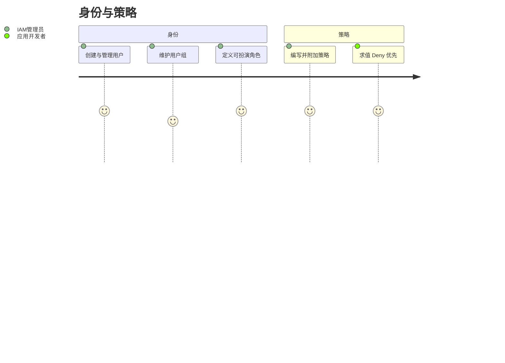
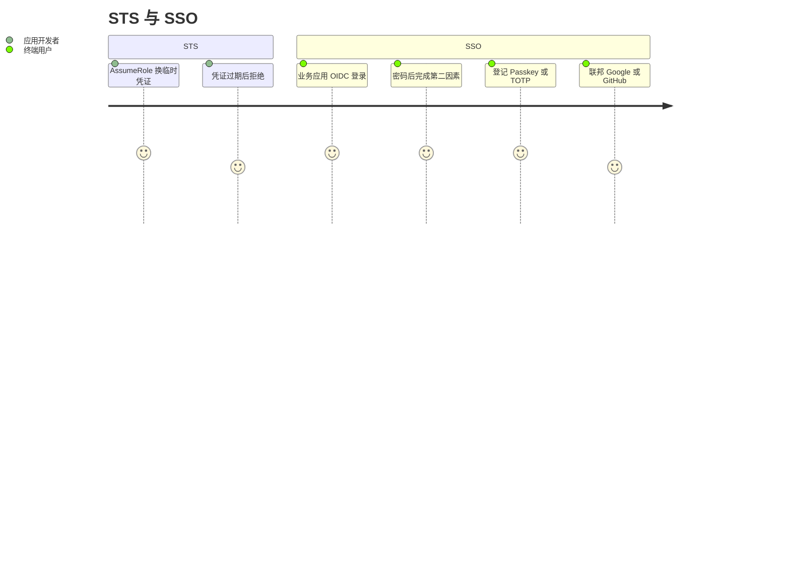
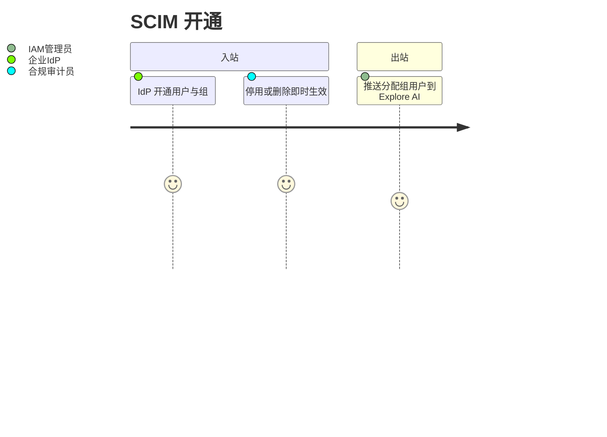
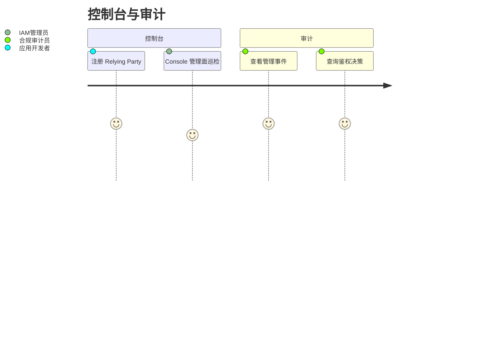
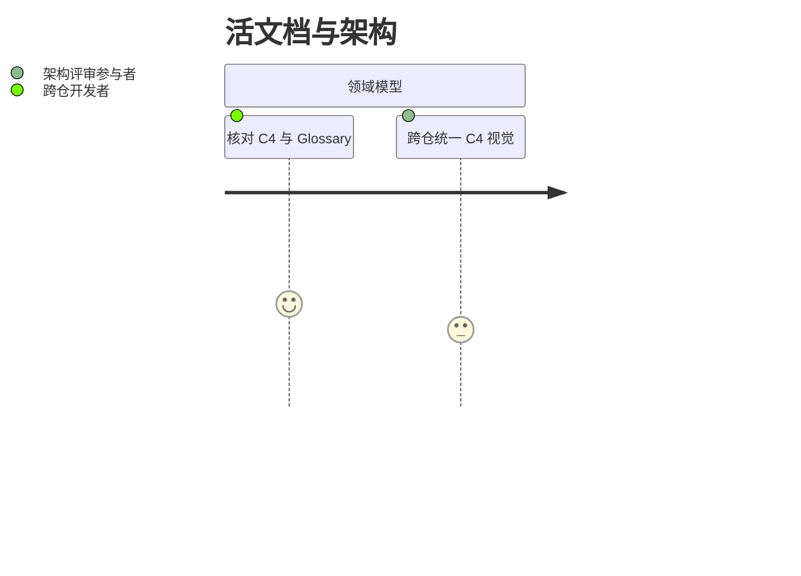

# 用户故事地图

> 格式：Jeff Patton 故事地图 + Mermaid journey + GWT（Epic 分文件）。  
> 故事正文与验收标准见 [user-stories/](./user-stories/)；本页只做索引，避免双源。

## 用户画像

| 角色 | 说明 |
|------|------|
| 终端用户 | 经 SSO 登录业务应用（Explore AI 等） |
| IAM 管理员 | 在 Console 管理用户、组、角色、策略与客户端 |
| 应用开发者 | 注册 Relying Party、集成 OIDC 与鉴权 |
| 合规审计员 | 查询管理事件与鉴权决策日志 |
| 企业 IdP | Okta / Entra ID 通过 SCIM 2.0 开通用户与组 |

## 旅程总览

### 身份与策略

### STS 与 SSO

### SCIM 开通

### 控制台与审计

### 活文档与架构

---

## Backbone 故事地图

### 规划中

| 身份 | 策略 | STS | SSO | 控制台与客户端 | 审计 |
|------|------|-----|-----|----------------|------|
| [US-01](./user-stories/E1-identity.md#us-01-管理-iam-用户) 管理用户 | [US-04](./user-stories/E2-policy.md#us-04-编写并附加策略) 编写/附加策略 | [US-06](./user-stories/E3-sts.md#us-06-assumerole) AssumeRole | [US-09](./user-stories/E4-sso-federation.md#us-09-联邦-googlegithub) 联邦 IdP | [US-10](./user-stories/E5-console-clients.md#us-10-注册-relying-party) 注册客户端 | [US-12](./user-stories/E6-audit.md#us-12-管理事件) 管理事件 |
| [US-02](./user-stories/E1-identity.md#us-02-管理用户组) 组 | [US-05](./user-stories/E2-policy.md#us-05-策略求值-deny-优先于-allow) 求值 Deny>Allow | [US-07](./user-stories/E3-sts.md#us-07-临时凭证过期) 凭证过期 | | [US-11](./user-stories/E5-console-clients.md#us-11-console-管理面) Console | [US-13](./user-stories/E6-audit.md#us-13-鉴权决策查询) 鉴权查询 |
| [US-03](./user-stories/E1-identity.md#us-03-管理角色) 角色 | | | | | |

### 已实现

| SSO | SCIM 开通 | 活文档与架构 |
|-----|-----------|--------------|
| [US-08](./user-stories/E4-sso-federation.md#us-08-oidc-登录业务应用) OIDC 登录 | [US-18](./user-stories/E8-scim-provisioning.md#us-18-外部-idp-通过-scim-开通用户与组) IdP 开通用户与组 | [US-14](./user-stories/E7-living-docs.md#us-14-领域模型图与代码一致) 领域图与代码一致 |
| [US-16](./user-stories/E4-sso-federation.md#us-16-mfa-第二因素后获得完整会话) MFA 第二因素 | [US-19](./user-stories/E8-scim-provisioning.md#us-19-iam-推送用户到-explore-ai) 推送到 Explore AI | [US-15](./user-stories/E7-living-docs.md#us-15-c4-图视觉风格跨仓一致) C4 视觉风格跨仓一致 |
| [US-17](./user-stories/E4-sso-federation.md#us-17-登记-passkey-或-totp) 登记 Passkey/TOTP | [US-20](./user-stories/E8-scim-provisioning.md#us-20-删除与停用即时生效) 删除与停用即时生效 | [US-21](./user-stories/E7-living-docs.md#us-21-模块间以领域事件解耦) 领域事件解耦 |

---

## Epic 索引

| Epic | 文件 | 故事 | 状态 |
|------|------|------|------|
| E1 身份 | [E1-identity.md](./user-stories/E1-identity.md) | US-01 – US-03 | 规划中 |
| E2 策略 | [E2-policy.md](./user-stories/E2-policy.md) | US-04 – US-05 | 规划中 |
| E3 STS | [E3-sts.md](./user-stories/E3-sts.md) | US-06 – US-07 | 规划中 |
| E4 SSO 与联邦 | [E4-sso-federation.md](./user-stories/E4-sso-federation.md) | US-08 – US-09, US-16 – US-17 | US-08 / US-16 / US-17 已实现 / US-09 规划中 |
| E5 控制台与客户端 | [E5-console-clients.md](./user-stories/E5-console-clients.md) | US-10 – US-11 | US-10 已实现 / US-11 规划中 |
| E6 审计 | [E6-audit.md](./user-stories/E6-audit.md) | US-12 – US-13 | 规划中 |
| E7 活文档与架构 | [E7-living-docs.md](./user-stories/E7-living-docs.md) | US-14 – US-15, US-21 | 已实现 |
| E8 SCIM 开通 | [E8-scim-provisioning.md](./user-stories/E8-scim-provisioning.md) | US-18 – US-20 | 已实现 |

## 参考

- [Guideline](../Guideline.md)
- [User Story Mapping — Jeff Patton](https://www.jpattonassociates.com/user-story-mapping/)
- [Domain Glossary](../Glossary.md)
- [AWS IAM User Guide](https://docs.aws.amazon.com/IAM/latest/UserGuide/introduction.html)
